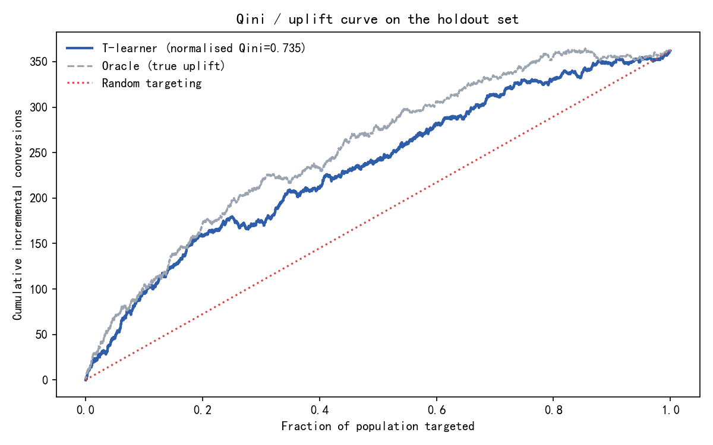
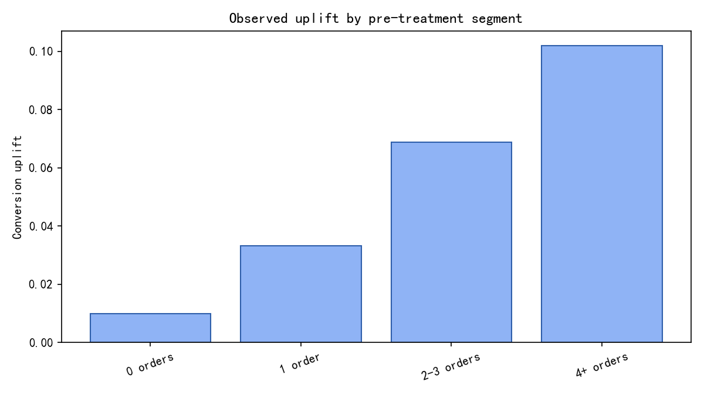

# 营销 A/B 实验效果与增量客群分析

> **数据声明**：本项目的数据由 `src/abtest/simulate.py` **模拟生成**（随机种子 `20240101`，
> 60,000 名用户，50/50 随机分流）。所有处理效应、转化率、收益均为模拟器设定，
> **不是任何真实营销活动的结果**。模拟器的真实效应已知，用来验证估计方法与增量模型是否可靠。

## 1. 实验设计与数据

- 实验单位：用户（`user_id`），一个用户只会出现在一个实验组
- 分流比例：期望 50% / 50%
- 主指标：转化率（binary）
- 次指标：人均 GMV（continuous，含大量 0）
- 协变量（仅实验前可得）：`prior_orders`、`recency_days`、`tenure_days`、`channel`、`device`
- 最小可检测效应（MDE，α=0.05、power=80%）：**0.59 个百分点**（按基线转化率与每组样本量估算）
- 模拟器真实参数：基线转化率 0.0725，实验组转化率 0.1122，
  真实 ATE（转化率）= **3.98 个百分点**，真实 ATE（人均 GMV）≈ 4.9804

## 2. 实验有效性检查

### 2.1 分流比例（SRM）

| 指标 | 数值 |
| --- | --- |
| 样本量 | 60,000 |
| 实验组 / 对照组 | 30,061 / 29,939 |
| 实际占比 | 0.5010（期望 0.50） |
| 卡方统计量 | 0.2481 |
| p 值 | 0.6184 |
| 是否检测到 SRM | 否 |

### 2.2 协变量平衡（SMD）

最大 |SMD| = 0.0156（阈值 0.1）。

| feature | level | mean_treated | mean_control | smd | balanced |
| --- | --- | --- | --- | --- | --- |
| prior_orders | (numeric) | 1.2073 | 1.1993 | 0.0072 | True |
| recency_days | (numeric) | 182.3072 | 181.2322 | 0.0102 | True |
| tenure_days | (numeric) | 645.0934 | 647.0894 | -0.0073 | True |
| channel | email | 0.103 | 0.0984 | 0.0153 | True |
| channel | organic | 0.4007 | 0.4004 | 0.0006 | True |
| channel | paid_search | 0.2931 | 0.3002 | -0.0156 | True |
| channel | social | 0.2033 | 0.201 | 0.0057 | True |
| device | desktop | 0.4055 | 0.3983 | 0.0145 | True |
| device | mobile | 0.5945 | 0.6017 | -0.0145 | True |

### 2.3 数据完整性

| check | rows | description |
| --- | --- | --- |
| duplicate_user_id | 0 | user_id must be unique |
| missing_values | 0 | no missing covariates |
| invalid_treatment | 0 | treatment must be 0/1 |
| negative_prior_orders | 0 | prior_orders >= 0 |
| recency_out_of_range | 0 | 0 <= recency_days <= 3650 |
| negative_revenue | 0 | revenue >= 0 |

## 3. 主指标结果

### 3.1 转化率（two-proportion z-test + 分层 Bootstrap）

| 指标 | 数值 |
| --- | --- |
| 实验组转化率 | 11.15% |
| 对照组转化率 | 7.19% |
| 绝对提升 | 3.96 pp |
| 相对提升 | 55.13% |
| 95% CI（z-test） | [3.50, 4.42] pp |
| p 值（z-test） | < 1e-300 |
| Bootstrap 95% CI | [3.50, 4.42] pp |
| Bootstrap p 值 | 0.0005 |

### 3.2 人均 GMV（Welch t-test + 分层 Bootstrap）

| 指标 | 数值 |
| --- | --- |
| 实验组人均 GMV | 15.26 |
| 对照组人均 GMV | 9.93 |
| 绝对提升 | 5.34 |
| 95% CI（Welch） | [4.51, 6.16] |
| p 值（Welch） | 5.43e-37 |
| Bootstrap 95% CI | [4.58, 6.19] |

### 3.3 多重比较（Holm-Bonferroni）

| metric | p_value | adjusted_p | rank |
| --- | --- | --- | --- |
| conversion_rate | < 1e-300 | < 1e-300 | 1 |
| revenue_per_user | 5.43e-37 | 5.43e-37 | 2 |

## 4. 增量模型（T-learner）

两个响应模型分别拟合实验组与对照组：`P(转化 | x, treated)` 与 `P(转化 | x, control)`，
增量分数 = 两者之差。模型特征只包含实验前协变量（`prior_orders, recency_days, tenure_days, channel, device`），
训练集/测试集按用户切分（70% / 30%）。

| 指标 | 数值 |
| --- | --- |
| 测试集用户数 | 17,919 |
| Qini 面积（模型） | 234.72 |
| Qini 面积（oracle 排序） | 254.14 |
| Qini 面积（随机排序基线，理论值 0.5·Q(n)） | 180.97 |
| 归一化 Qini 系数（0 = 随机触达，1 = oracle） | 0.7346 |
| 模型分数与真实 uplift 的 Spearman 相关 | 0.8301 |
| Top 10% 预测增量的观测 uplift | 10.95 pp |
| 全样本观测 uplift | 3.96 pp |

### 4.1 按预测增量分层（holdout）

| decile | n | conversion_treated | conversion_control | uplift | ci_low | ci_high |
| --- | --- | --- | --- | --- | --- | --- |
| 1 | 1792 | 0.2281 | 0.1186 | 10.95 | 7.47 | 14.42 |
| 2 | 1792 | 0.1494 | 0.0809 | 6.85 | 3.91 | 9.79 |
| 3 | 1792 | 0.1052 | 0.087 | 1.82 | -0.91 | 4.55 |
| 4 | 1792 | 0.1127 | 0.0722 | 4.06 | 1.38 | 6.73 |
| 5 | 1792 | 0.1181 | 0.084 | 3.41 | 0.63 | 6.19 |
| 6 | 1792 | 0.1218 | 0.0783 | 4.35 | 1.59 | 7.11 |
| 7 | 1792 | 0.0898 | 0.0562 | 3.36 | 0.96 | 5.76 |
| 8 | 1792 | 0.0647 | 0.0428 | 2.2 | 0.11 | 4.28 |
| 9 | 1792 | 0.0598 | 0.0421 | 1.78 | -0.25 | 3.81 |
| 10 | 1791 | 0.061 | 0.0438 | 1.72 | -0.34 | 3.78 |

> `uplift` 单位：百分点。"Top 10%" 是模型认为最可能被营销影响的用户，用于决定触达优先级，
> 不代表这些用户一定被"个体提升"了同样幅度。

### 4.2 按实验前分层（观察值，不依赖模型）

| segment | n | conversion_treated | conversion_control | uplift | ci_low | ci_high | p_value |
| --- | --- | --- | --- | --- | --- | --- | --- |
| 0 orders | 18047 | 0.0618 | 0.0519 | 0.99 | 0.31 | 1.67 | 4.09e-03 |
| 1 order | 21613 | 0.1001 | 0.067 | 3.32 | 2.58 | 4.05 | < 1e-300 |
| 2-3 orders | 18268 | 0.159 | 0.0902 | 6.88 | 5.93 | 7.83 | < 1e-300 |
| 4+ orders | 2072 | 0.2404 | 0.1385 | 10.19 | 6.86 | 13.52 | 2.07e-09 |

## 5. 结论与业务建议

1. **实验有效性**：SRM 未触发、最大 |SMD| < 0.1，随机分流可信，指标差异可归因于实验处理。
2. **主指标**：转化率提升 3.96 pp（95% CI 3.50–4.42 pp），
   与模拟器设定的真实 ATE 3.98 pp 落在同一量级，说明估计流程没有系统性偏差。
3. **增量模型**：归一化 Qini 系数 = 0.735（0 = 随机触达，1 = oracle），
   说明按模型排序触达确实优于随机；但距离 oracle 仍有差距，Top 10% 的观测 uplift 为 10.95 pp。
4. **分层**：`2-3 orders` 与 `4+ orders` 用户的历史订单越多，增量越大；`0 orders` 用户增量接近 0，
   不建议对纯新客做大规模补贴（见 §4.2 的置信区间）。
5. **决策建议**：优先触达 Top 30% 预测增量用户，预算有限时按 uplift/成本 排序；对增量不显著的分层减少投入。

## 6. 方法说明与局限

1. **模拟数据**：结论描述的是模拟器，不是真实业务；真实实验需要幂等分流、日志校验与更长的观察窗。
2. **个体效应不可识别**：T-learner 预测的是"响应概率之差"，只适合排序；不能把某个用户的预测值
   当成真实个体因果效应（fundamental problem of causal inference）。
3. **Qini/AUUC 定义**：按预测分排序后 `Q(k) = Y_t(k) − Y_c(k)·N_t(k)/N_c(k)`；AUUC 为对累计人群占比的
   梯形积分；归一化 Qini 系数 = `(模型面积 − 随机排序面积) / (oracle 面积 − 随机排序面积)`。
   随机排序的面积不为 0（触达全量时仍能获得平均增量），所以必须用随机基线而不是 0 来归一化。
   换一种定义数字会变，文档已写死在 `src/abtest/uplift.py`。
4. **多重比较**：同时检验转化率与人均 GMV，已做 Holm 校正；未做序贯检验（peeking）校正。
5. **收益指标**：实验期内人均 GMV 方差大、零值多，Welch 与 Bootstrap 都给出区间，但长期 LTV 无法从
   一次实验推断。
6. **模型选择**：T-learner + 梯度提升树，未调参、未做交叉验证；作为增量排序 baseline 足够，但不应
   宣称其最优。
