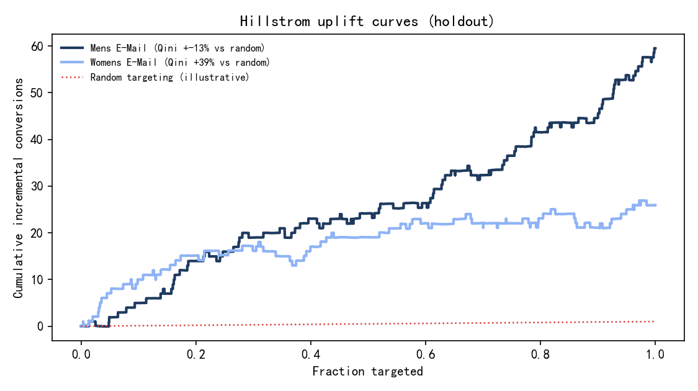
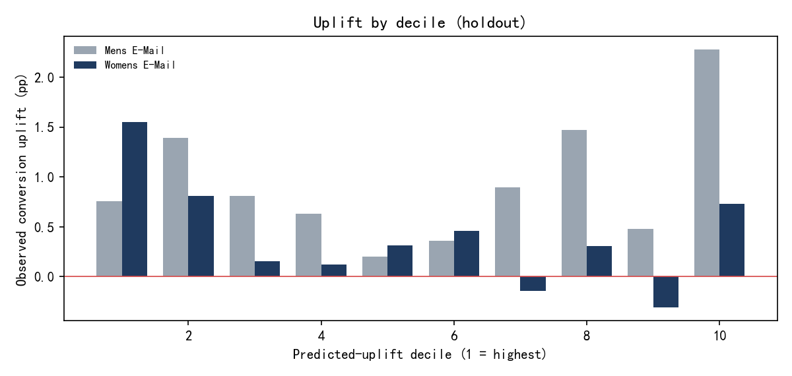
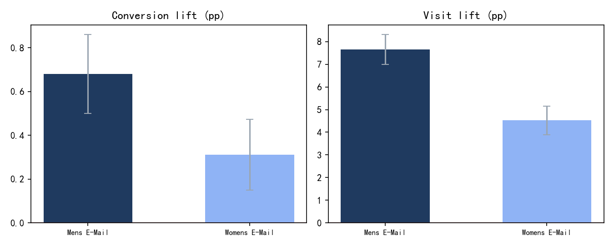

# Hillstrom 邮件实验：三组对比与增量客群分析

> **数据来源**：Kevin Hillstrom 公开邮件实验（MineThatData E-Mail Analytics Challenge，2008），
> 64,000 名顾客，男士邮件 / 女士邮件 / 无邮件三组，结局为访问（visit）、转化（conversion）和消费（spend）。
> 这是**真实公开数据**，不是模拟数据。

## 1. 分组校验

| 组 | 人数 |
| --- | --- |
| Womens E-Mail | 21,387 |
| Mens E-Mail | 21,307 |
| No E-Mail | 21,306 |

- 三组 SRM 卡方：χ²=0.20，p=0.904，未检测到异常
- 协变量最大 |SMD| = 0.016（阈值 0.1）

## 2. 三组效果（vs 无邮件）

| 组 | 转化率 | 转化提升 | 转化 95% CI | 访问提升 | 人均消费提升 |
| --- | --- | --- | --- | --- | --- |
| Mens E-Mail | 1.25% | +0.68 pp | [0.50, 0.86] | +7.66 pp | +$0.77 |
| Womens E-Mail | 0.88% | +0.31 pp | [0.15, 0.47] | +4.52 pp | +$0.42 |

Holm 校正后（6 个检验）：

| metric | p_value | adjusted_p | rank |
| --- | --- | --- | --- |
| Mens E-Mail / visit | 0.00e+00 | 0.00e+00 | 1 |
| Womens E-Mail / visit | 0.00e+00 | 0.00e+00 | 2 |
| Mens E-Mail / conversion | 1.47e-13 | 5.88e-13 | 3 |
| Mens E-Mail / spend | 1.16e-07 | 3.49e-07 | 4 |
| Womens E-Mail / conversion | 1.56e-04 | 3.12e-04 | 5 |
| Womens E-Mail / spend | 1.13e-03 | 1.13e-03 | 6 |

## 3. 增量模型（T-learner）

对每个处理组单独与对照组建模，70/30 按用户切分，特征为 recency、history、channel、zip_code、history_segment。

| 组 | 测试集 | Qini 面积 | 随机基线 | 相对随机 | Top 10% 增量 |
| --- | --- | --- | --- | --- | --- |
| Mens E-Mail | 12,863 | 25.96 | 29.74 | -12.7% | 0.76 pp |
| Womens E-Mail | 12,886 | 18.08 | 12.97 | +39.4% | 1.55 pp |

## 4. 结论与局限

1. 男士邮件对转化、访问和消费的提升都更大且显著；女士邮件也有正效果，但幅度约为男士的一半。
2. 增量排序在女士邮件组优于随机（Qini 面积高约 39%），
   男士邮件组排序不稳定（Qini 低于随机），说明"知道有平均效果"不等于"能可靠挑出高增量人群"。
3. 局限：单零售商、2008 年、邮件渠道、短期窗口；没有成本字段，无法直接算 ROI；结论不能外推到其他市场。

